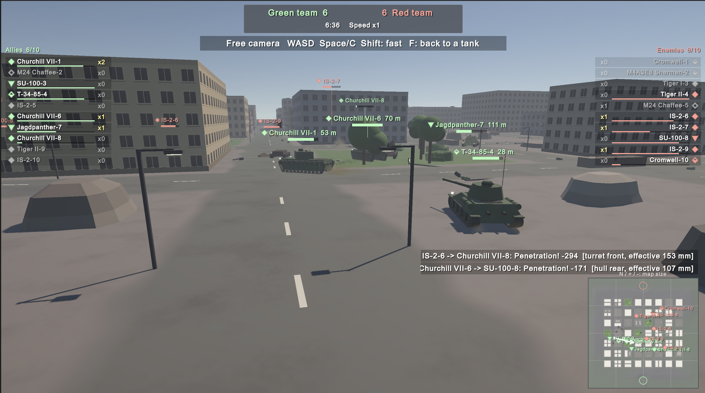
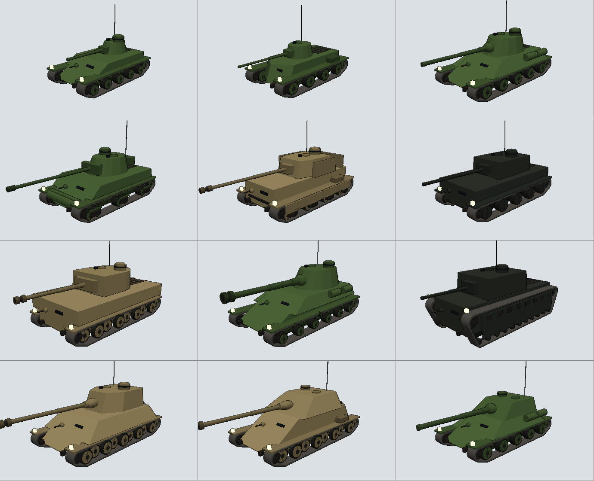
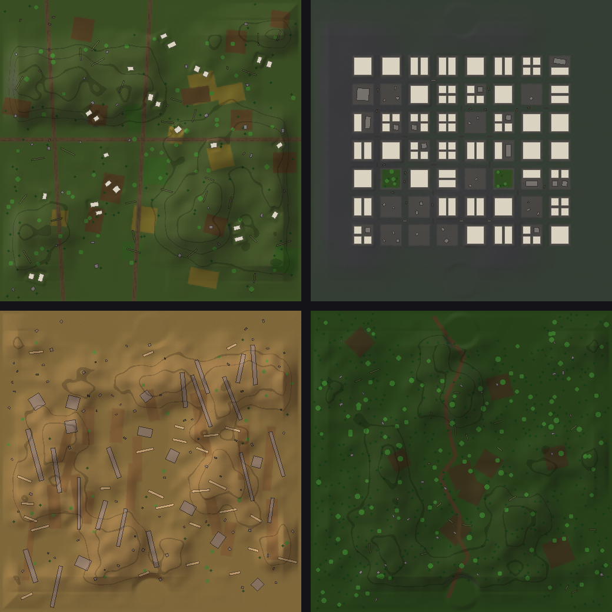

# Tank Battle

A tank combat game made in Unity, where **everything is generated in
code**: the maps, the tank models, the effects, the interface and the sound. The project has no
3D models, textures or audio from outside, apart from one engine recording.

<!-- Gameplay video: on github.com, open this file, click the pencil (Edit), drag your .mp4 here
     (under 10 MB), and GitHub replaces it with a link that plays right on this page. -->

https://github.com/user-attachments/assets/69ad8d54-38fd-4531-acd9-dc8d6dcc2a47

## Highlights

- **Real armour mechanics.** Convex hull and turret colliders with real slopes; effective
  thickness from the impact angle, ricochets, overmatch, AP and HE shells, spaced armour on
  tracks and side skirts, ammo-rack explosions.
- **Twelve Second World War tanks** with their real armour, guns, top speeds and gun
  elevation: M24 Chaffee, BT-7, T-34-85, Sherman, Panzer IV, Cromwell, Tiger I, IS-2,
  Churchill, Tiger II, Jagdpanther, SU-100. Every model is built from code.
- **Tank designer.** Hull, turret, gun, engine and six armour plates; weight comes from the
  steel volume, so armour costs mobility. Mix the real tanks' parts on your own design.
- **Ballistics and spotting.** Shells fly with gravity; the sight shows where the shot will
  land and the chance of hitting. Enemies stay hidden until your team spots them; bushes,
  camouflage and firing all matter.
- **AI** with A* pathfinding, hull-down firing positions, reloading in cover, aiming at weak
  spots, role-based tactics for light, medium and heavy tanks, and shared sightings.
- **Procedural 600 m maps** with hills: countryside, city, canyon and forest. Trees and
  fences fall over when hit, tanks climb over logs and tilt with the ground.
- **Challenge mode:** 30 levels where you build a team on a budget under extra rules.
  Prices come from each tank's combat value.
- **Synthesised sound:** cannon shots with echo and reverb, armour hits, ricochets,
  explosions and track noise, all generated at runtime.

## Built with

Unity 6, C#. About 13,000 lines across 81 scripts; no Asset Store packages.

## Source code

The source code is private. If you would like to see it, get in touch.

## Credits

Engine sound: "Engine-loop heavy vehicle/tank" by Nayckron, based on work by qubodup
([OpenGameArt](https://opengameart.org/content/engine-loop-heavy-vehicletank)), CC-BY 3.0.
