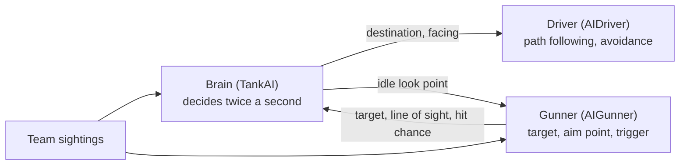

# The AI

Every computer-controlled tank runs the same three parts. All difficulty levels use the same
tactics; only reaction time, aiming error and patience change, so an easy AI still plays
sensibly instead of driving into walls.

## The brain: one mode at a time

Twice a second the brain picks the first mode that applies:

| Mode | When |
|---|---|
| Defend | my base is being captured and I am close, or have nothing else to do |
| Retreat | badly hurt and outnumbered: back into cover, still shooting |
| Hide | (medium / heavy) just fired and the reload is long: back into cover, return just before the gun is loaded |
| Engage | an enemy is spotted: go to the best firing spot and fight |
| Evade | hit by someone I cannot see: get into cover from the shot's direction |
| Investigate | an enemy was seen recently by me or a team-mate: go and look |
| Scout | (light) hop from bush to bush ahead of the team and sit still |
| Advance | nothing known: move up my lane, further forward as the battle goes on |

Roles come from the tank class: light tanks scout, mediums flank on the side lanes, heavies
lead in the centre with their front armour angled.

## Choosing where to stand

Firing spots are found by sampling a few dozen positions (rings around the tank, plus an arc at
the preferred range around the target) and asking, for each one, **"what would the enemy see if
my tank stood here?"** Two raycasts from the enemy's eye answer it: one to where my turret would
be, one to where my hull would be. If the enemy cannot see my turret, I cannot shoot it from
there, so the spot is dropped.

| Term | Score |
|---|---|
| distance from the preferred range | −1 per 40 m |
| hull hidden, turret visible (hull-down) | +2 (heavy +2.5) |
| inside a bush | +1 (light +2) |
| facing the target's side (flankers) | +0.8 |
| distance I must drive | −1 per 35 m |
| already there | +0.3 |
| each other enemy that could see me there | −0.7 |

Spots next to a team-mate, or in front of a team-mate's gun on its way to the target, are
skipped, so tanks do not block each other's shots. Cover is the same search turned around: the
nearest spot where the threat cannot see even my turret.

## The gunner

- **Target choice** scores every spotted enemy: closer, more damaged, in clear view, likely to
  be penetrated, the one that just shot me, or one standing in my base.
- **Weak spots.** Several points on the target (hull centre, lower hull, front and rear halves,
  turret, tracks) are tested by casting a ray from the gun to each and running the real armour
  rules on the plate it would hit. The AI aims at the best one: side armour, lower plates, a
  turret it can get through. Far away, with a wide aim circle, it settles for the middle.
- **Leading.** Moving targets are led by the shell's flight time.
- **Skill.** A deliberate aiming error (0.35 to 2.2 m at 100 m by difficulty) is added on top.
- **The trigger.** It fires when the gun is loaded, the target has been in view for the
  reaction time, the aim circle has closed enough for its class, a simulated shell would reach
  the target and not a wall or a team-mate, and the **hit chance** (19 imaginary shells over
  the aim circle) is high enough. The longer it has been ready, the less fussy it gets.

## Moving

- **Navigation grid.** The map is cut into 4 m cells. A cell is blocked if an obstacle is
  within 3.2 m (half a tank's width plus room) or the ground is steeper than 26°. Trees are not
  obstacles: tanks knock them over.
- **Paths.** A* over the free cells, then the path is straightened so tanks drive long straight
  legs instead of zig-zagging from cell to cell.
- **Local avoidance.** A short sensor ahead (behind when reversing) slows down and swerves around
  other tanks. A tank standing still pulls aside when a team-mate, or the player, drives at it.
- **Getting unstuck.** Driving without moving for 1.4 s makes it back out and plan a new
  route. After three failed attempts it is moved to the nearest open cell (the same "get free"
  the player has on X).

## Shared information

Spotting is per team: what one tank sees, the whole team sees. A tank is spotted when it is
within 50 m, or within `view range × (1 − camouflage)` with a clear line of sight. Camouflage
grows for small, stationary tanks and tanks in bushes, adds 0.25 per bush on the line of sight,
and mostly disappears for a few seconds after firing.

When a tank drops out of sight, its **last seen position** stays known to the team. The AI goes
to look there or keeps its gun pointed at it, the same information the player gets as fading
marks on the minimap.

## No stand-offs

Two AI teams that both like hull-down spots can end up sitting behind crests trading misses
forever. Three things prevent it:

1. **Boldness.** Once nobody on either side has damaged anyone for 20 s, every AI gets bolder,
   reaching full boldness after a minute: its preferred range shrinks to about half, hull-down
   spots lose most of their value, and the advance toward the enemy base speeds up.
2. **Missing.** Every three misses in a row bring the preferred range 25% closer.
3. **Bad angles.** If the gun is ready but the hit chance stays low for 4 s (only a turret
   showing over a crest), it picks a closer spot instead of waiting.

## What went wrong along the way

- **Holding fire because of its own scatter.** The pre-fire check used to fly a shell along
  the gun's actual direction, which includes the AI's deliberate aiming error. Whenever that
  error pushed the aim just off the target, the check failed and the tank waited for seconds.
  The check now flies the shell at the *true* aim point; the error only affects where the real
  shell goes.
- **Team-mates in the way.** AI tanks picked firing spots in front of each other's guns and
  parked where the player was driving. Spots now exclude team-mates' positions, destinations and
  lines of fire, and parked tanks make way.
- **Battles that stalled** led to the boldness and miss rules above.
