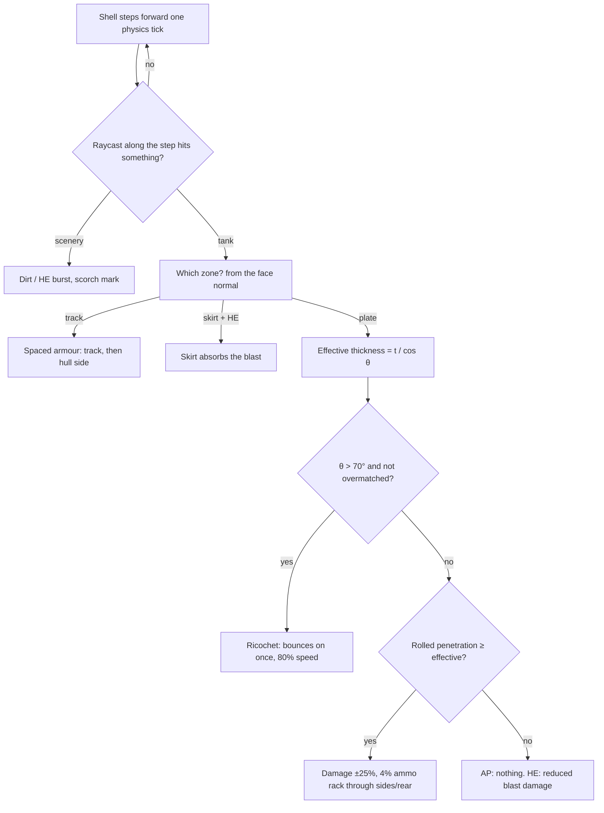

# Armour and ballistics

How a shell gets from the gun to a damage number. Every rule lives in one class with no scene
objects in it, so the whole model can be read, tested and rebalanced in one place; the shell
only applies the result.



## One collider per part, real slopes

The hull and the turret each have a single **convex mesh collider** built from the same outline
as the visible model, so a 60° glacis really is a 60° face. There are no invisible armour boxes.

The zone a shell hit is worked out from the **normal of the face** it struck, turned into the
part's own coordinates:

| Face normal (local) | Zone |
|---|---|
| z > 0.45 | front |
| z < −0.45 | rear |
| y > 0.7 | roof |
| otherwise | side |

Front and rear are tested before the roof on purpose: a steep glacis points upward a lot, but
it is still the front plate. Tracks and side skirts are separate boxes with a fixed zone.

## The armour rules

| Rule | Formula |
|---|---|
| Effective thickness | `t / cos θ`, θ = angle between the shell's path and the face normal |
| Ricochet | AP only, θ > 70°, unless overmatched |
| Overmatch | calibre > 3 × plate thickness: the shell cannot ricochet |
| Penetration | rolled penetration (±15%) ≥ effective thickness |
| Damage | ±25% |
| HE without penetration | `0.5 × damage − 1.1 × thickness` blast damage |

Because the angle comes from the real 3D shell direction and the real face, **angling the hull
works on its own**: no special case is needed. A T-34-85 glacis (45 mm at 60°) is 90 mm to a
shell from dead ahead; the same plate turned 30° to the side becomes 104 mm, because the two
angles combine (`45 / (cos 60° × cos 30°)`).

## Tracks are spaced armour

A track (20–30 mm, by hull size) stands in front of the lower hull side. Both face the same
way, so one impact angle thickens both:

| Rolled penetration | Result |
|---|---|
| below the track's effective thickness | the track holds, nothing happens |
| through the track, not through track + hull side | the track breaks, no damage |
| through both | the track breaks **and** full damage |

HE breaks a track it beats, but its blast has to get through track and side together to hurt
the crew. Side skirts are extra spaced plating that stops HE completely.

## Ballistics

Shells fly under gravity and **raycast along each physics step** (0.02 s) before moving. At
900 m/s a step is 18 m, far longer than any plate is thick, so a shell can never tunnel through
armour between two frames, and no fast-moving collider is needed.

The gun compensates for drop. The firing angle that lands a shell of speed *v* on a point *d*
metres away and *h* metres higher is the flatter solution of

```
tan θ = (v² − √(v⁴ − g(g d² + 2 h v²))) / (g d)
```

The angle is worked out in the world (gravity points straight down even when the tank stands on
a slope), then turned into the turret's own frame to get the gun's pitch, and clamped to that
tank's real elevation and depression (a T-34-85 only depresses 5°, a Churchill 12°).

### One integrator for everything

The gun sight, the AI and the shell all use the **same step-by-step flight**. The sight flies an
imaginary shell from the muzzle and draws its circle where that shell would really land, so a
rock or a crest in the way shows up on screen before you fire.

### Hit chance

Every shot lands at a random point in the aim circle. To show how many would actually hit,
imaginary shells are flown to **19 points spread evenly over the circle** (a sunflower pattern:
radius `√((k + 0.5) / 19)`, angle `k × 137.5°`, so each point covers the same area as a random
pick would) and the ones that land on the target's armour or tracks are counted. A tank showing
only its turret over a crest gets a low number, because most of the circle hits the ground in
front of it. The AI uses the same number to decide whether to fire or move.

## What went wrong along the way

- **The sniper view sat above the gun.** The zoomed camera was placed 0.55 m above the gun, so
  it could see over a small rise that the gun, lower down, shot straight into: the circle sat on
  the ground 17 m ahead while the crosshair was on the enemy. The view now looks along the gun's
  own axis, and your own tank is hidden while zoomed in (it still casts its shadow).
